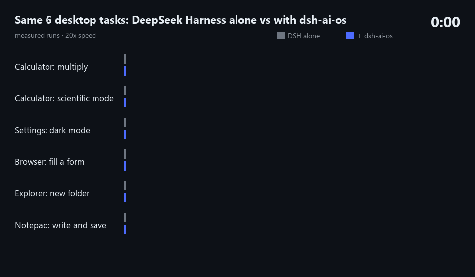

# AI OS

[中文](README.md) · [npm](https://www.npmjs.com/package/dsh-ai-os) · [PyPI](https://pypi.org/project/ai-os-desktop/)

**Press F8, say what you want, and DeepSeek operates your Windows desktop.** On the same 6 desktop tasks, the median time drops from 166 s to 26 s with this plugin, using half the tokens.



```sh
pip install ai-os-desktop      # Python side: 13 desktop tools over MCP
dsh plugin add dsh-ai-os       # DeepSeek Harness side: voice button + tool wiring
# restart DeepSeek Harness, press F8 and say "open Notepad and write a poem"
```

Free, MIT licensed, Windows only.

## What it is

- **`dsh-ai-os`**, a [DeepSeek Harness](https://github.com/deepseek-ai/deepseek-harness) plugin: a voice button (F8 to talk, replies read aloud) plus desktop tools for the agent.
- **`ai-os-mcp`**, the MCP server behind it. It works with any MCP client (Claude Code, Cursor, …) as a stdio server.
- **`ai-os`**, a standalone voice assistant that needs only a `DEEPSEEK_API_KEY`.

The agent reads the foreground window through Windows UI Automation and gets a numbered list of controls. It clicks them by number, types (Chinese included), presses hotkeys, scrolls, switches windows and launches apps. Every action that changes the screen returns only the controls that appeared or disappeared, so the agent confirms each step without a screenshot. Web pages and Electron apps, where UI Automation sees little, fall back to a screenshot and a vision model.

## Results

Same Windows 11 machine, same 6 tasks (Calculator input, Calculator mode switch, dark mode in Settings, a browser form, a new folder in File Explorer, writing and saving in Notepad), DeepSeek Harness with `deepseek-flash`, plugin off vs on:

| | DeepSeek Harness alone | + dsh-ai-os |
|---|---|---|
| Success | 6/6 | 6/6 |
| Median time | 166 s | 26 s |
| Tool calls (avg) | 12.3 | 9.2 |
| Tokens (avg) | 648K | 326K |

Without the plugin, the agent writes PowerShell that simulates keystrokes, screenshots the result and retries. With it, the agent clicks controls by number.

One run per task, measured 2026-11-16, with one exception: the first plugin-on run of "Calculator: multiply" exposed a bug where `open_app` didn't wait for the new window (95 s). After the fix it was rerun at 27 s, and the table uses the rerun. Every raw run is in [`benchmark/results.jsonl`](benchmark/results.jsonl), and the GIF above is rendered from that file by [`scripts/make_race_gif.py`](scripts/make_race_gif.py). Reproduce with `python -m benchmark run --mode off|on`.

The success rate is the same on these tasks. The gain is speed, and it matters most for voice, where nobody wants to wait three minutes for an answer. In a real session, "list every open window" took **17 min 10 s and 27 steps** without the tools (the agent wrote `EnumWindows` PowerShell and hit an approval prompt on every step), and **3 s** with them.

## Background mode: no DeepSeek Harness window needed

```sh
ai-os service start      # run the background assistant
ai-os service enable     # optional: start it when you log into Windows
```

Then press **Ctrl+Alt+Space** in any app and speak; the DeepSeek Harness window doesn't need to be open. **Ctrl+Alt+Esc** stops at any point (listening, working or reading aloud) and returns to standby; Ctrl+Alt+Space while it reads interrupts and listens again. A status bar appears at the top of the screen only while it works, and you can follow up for a few seconds in the same conversation ("close it" knows what "it" is).

- **Speech is recognized locally** with the SenseVoice model that DeepSeek Harness's Voice Input plugin downloads, so audio stays on your machine. Enable Voice Input in DSH once and finish its model setup.
- **No extra API key.** Requests run through `dsh --profile headless` with the account you signed into in the desktop app. Your own DSH profiles are not modified.
- **Shell commands are read-only by default**, since nobody is there to approve them. Desktop actions go through the ai-os tools and are unaffected. Set `AI_OS_PERMISSION_MODE=workspace-write` to loosen it.
- **Optional wake word:** set `WAKE_WORD` in `%LOCALAPPDATA%\ai-os\.env` and download the wake model (`pip install "ai-os-desktop[wake]"`, then `python -m ai_os.wake`).
- While DeepSeek Harness is open, the hotkey goes to the background assistant; when the assistant stops, the hotkey goes back to bringing up the DSH window.

`ai-os service status` exits 0 (running), 1 (not running), 2 (running with a problem) or 3 (needs setup). The assistant restarts itself after a crash; only `ai-os service stop` stops it.

## Install from the DSH plugin market

Under **Plugins**, enable the experimental **Custom plugin index** plugin, then **Discover → Add index source** and paste:

```
https://cdn.jsdelivr.net/npm/dsh-ai-os/market-index.json
```

The market installs the DeepSeek Harness side only; `pip install ai-os-desktop` is still needed.

## Safety

The MCP server exposes no shell tool; commands go through DeepSeek Harness's own approval flow. Moving the mouse to the top-left corner of the screen aborts any action.

## Development

```sh
pip install -e .
python -m ai_os --text        # standalone assistant, keyboard input
python -m ai_os.mcp_server    # MCP server over stdio
```
