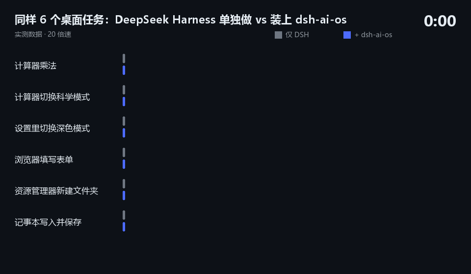

# AI OS

[English](README.en.md) · [npm](https://www.npmjs.com/package/dsh-ai-os) · [PyPI](https://pypi.org/project/ai-os-desktop/)

**按 F8 说一句话，DeepSeek 替你操作 Windows 电脑。** 同样 6 个桌面任务，装上插件后耗时中位数从 166 秒降到 26 秒，token 少一半。



```sh
pip install ai-os-desktop      # Python 端：13 个桌面工具
dsh plugin add dsh-ai-os       # DeepSeek Harness 端：语音按钮 + 接入工具
# 重启 DeepSeek Harness，按 F8 说「打开记事本写一首诗」
```

免费、MIT 开源，只支持 Windows。数据来源和复现方法见下文[实测效果](#实测效果)。

两种用法：

- **独立语音助手** `ai-os`：说“小爱，打开记事本写一首诗”，它会读取屏幕控件、点击、输入，并用语音汇报结果。
- **DeepSeek Harness 插件** `dsh-ai-os`：把桌面控制能力以 MCP 工具的形式提供给 DeepSeek Harness（也适用于 Claude Code、Cursor 等任何 MCP 客户端）。

## 安装

```sh
pip install ai-os-desktop
```

## 独立语音助手

在任意目录创建 `.env`（参考 [.env.example](.env.example)），至少填写 `DEEPSEEK_API_KEY`，然后：

```sh
ai-os            # 语音模式
ai-os --text     # 键盘输入指令，调试用
ai-os --once "打开设置调高亮度"
```

语音模式下屏幕顶部会显示一个状态条（待命 / 聆听 / 识别 / 思考 / 执行 / 说话），它不抢焦点、鼠标可以点穿；不需要时加 `--no-overlay`。

唤醒词默认在本地离线识别，说出唤醒词之前的声音不会上传：

```sh
pip install "ai-os-desktop[wake]"
python -m ai_os.wake      # 下载唤醒模型（约 33 MB）
```

听到“嘀”一声后说指令；也可以一口气说“小爱，打开计算器”。没装本地模型时自动退回云端识别唤醒词。

## 接入 DeepSeek Harness

```sh
dsh plugin add dsh-ai-os
```

其他 MCP 客户端可直接把 `ai-os-mcp` 配置为 stdio 服务器。

### 从插件市场安装（插件作者和用户都走这条）

DSH 没有官方插件索引，插件靠「索引文件」分发：一个 JSON 列出可安装的插件和版本。本项目的索引随 npm 包一起发布，所以不需要额外托管：

```
https://cdn.jsdelivr.net/npm/dsh-ai-os/market-index.json
```

这个地址始终指向最新版。如果所在网络连不上 jsDelivr，改用带版本号的 `https://unpkg.com/dsh-ai-os@<版本号>/market-index.json`（不带版本号的 unpkg 地址会重定向，DSH 不接受）。

在 DeepSeek Harness 里：

1. 侧栏 **插件** → 打开实验性插件 **自定义插件索引**
2. 切到 **发现** 标签 → **添加索引源** → 粘贴上面的地址
3. 列表里会出现「AI OS · 语音操作电脑」，点进去可以看详情、直接安装
4. 市场只安装 DeepSeek Harness 端，Python 端仍需 `pip install ai-os-desktop`

自建索引时改 `scripts/build_market_index.py`，用 `scripts/validate_market_index.mjs` 按 DSH 的官方校验规则验证，格式错了用户那边就装不上。

插件还在输入框旁加了一个语音对话按钮：按 **F8**（或点按钮）开始说话，说完自动发送；任务完成后朗读回复，随后几秒内可以直接接着说。朗读时按 F8 打断，Esc 取消。

在别的程序里按 **Ctrl+Alt+Space** 也能用：它会把 DeepSeek Harness 拉到前台并开始听。这个热键由 `ai-os-mcp` 进程注册，所以依赖 Python 端正常运行。

`ai-os-mcp` 通过 MCP 提供 13 个桌面工具（读控件、点击、输入、按键、滚动、开应用/网址/文件、列窗口、切窗口、截图问视觉模型、等待）。它没有暴露命令执行工具，需要跑命令时由 DeepSeek Harness 自己的终端工具处理，走它自己的审批。

如果 agent 还是去写 PowerShell 而不是用这些工具，在工作区放一个 `AGENTS.md` 说明优先用 `ai-os` 工具即可（本仓库根目录有一份可以直接参考），或重启 DeepSeek Harness 让工具列表和指令重新加载。

语音识别复用 DeepSeek Harness 官方的**语音输入**插件（实验功能），无需另外配置 API Key：在侧栏**插件**中打开它，并按提示完成一次模型准备即可。插件页的「运行检查」会实地读取 MCP 状态：桌面工具连不上时这一行会变红并给出具体原因，不会假装正常。

## 后台常驻：不打开 DeepSeek Harness 也能用

```sh
ai-os service start      # 启动后台助手
ai-os service enable     # 可选：登录 Windows 后自动启动
```

之后在任何程序里按 **Ctrl+Alt+Space** 说话即可，DeepSeek Harness 的窗口不需要开着。按 **Ctrl+Alt+Esc** 随时停止：正在听、正在执行、正在朗读都会立刻停下，回到待命；朗读时再按 Ctrl+Alt+Space 则是打断并重新听。屏幕顶部的状态条只在工作时出现；说完后几秒内可以接着说，同一段对话会记住上下文（“把它关掉”知道“它”是什么）。

- **语音识别在本地完成**：直接复用 DeepSeek Harness「语音输入」插件下载的 SenseVoice 模型，声音不上传。需要先在 DSH 里启用一次「语音输入」并完成模型准备。
- **不需要另配 API Key**：任务交给 `dsh --profile headless` 执行，用的是你在 DeepSeek Harness 桌面版里登录的账号。你自己的 DSH 配置不会被修改。
- **默认只读执行命令**：后台没人点审批，所以 DSH 的终端工具默认是只读沙箱；桌面操作走 ai-os 工具，不受影响。需要放宽时设置环境变量 `AI_OS_PERMISSION_MODE=workspace-write`。
- **唤醒词可选**：在 `%LOCALAPPDATA%\ai-os\.env` 里设置 `WAKE_WORD=小爱` 并下载唤醒模型（见上文），就可以不按键直接喊。
- DeepSeek Harness 开着时，快捷键自动交给后台助手；后台助手停止后，快捷键恢复为唤起 DSH 窗口。

| 命令 | 作用 |
| --- | --- |
| `ai-os service status` | 查看状态（退出码 0 正常 / 1 未运行 / 2 部分异常 / 3 需要设置） |
| `ai-os service stop` / `restart` | 停止 / 重启 |
| `ai-os service disable` | 取消开机自启 |
| `ai-os service logs` | 最新日志的路径 |

后台助手崩溃时会自动重启；只有 `stop` 会让它停下。

## 实测效果

同一台 Windows 11 电脑、同样的 6 个桌面任务（计算器输入、计算器切换模式、系统设置切换深色模式、浏览器填写表单、资源管理器新建文件夹、记事本写入并保存），在 DeepSeek Harness 中分别关闭和开启 `dsh-ai-os` 运行，模型均为 `deepseek-flash`：

| | 仅 DeepSeek Harness | + dsh-ai-os |
|---|---|---|
| 成功率 | 6/6 | 6/6 |
| 耗时中位数 | 166 秒 | 26 秒 |
| 平均工具调用 | 12.3 次 | 9.2 次 |
| 平均 token 用量 | 648K | 326K |

不装插件时，DeepSeek Harness 需要现写 PowerShell 脚本模拟按键、截图看图、再修改脚本；装上后直接按控件编号点击，每步只回传界面变化。每个任务各运行一次，测试于 2026-11-16；唯一例外是「计算器乘法」：开启插件的首次运行暴露了 `open_app` 不等待新窗口的 bug（95 秒），修复后重跑为 27 秒，表中用的是重跑结果。原始记录全部在 [`benchmark/results.jsonl`](benchmark/results.jsonl)，开头的动图由 [`scripts/make_race_gif.py`](scripts/make_race_gif.py) 从这份记录生成。复现方法见 [benchmark](benchmark/__main__.py)：`python -m benchmark run --mode off|on`。

真实会话里差距更大。同一个「列出当前所有窗口」的请求：桌面工具不可用时用时 **17 分 10 秒、27 步**，因为它去写 `EnumWindows` 的 PowerShell，每步都撞上 `danger-full-access` 审批；桌面工具可用后 **3 秒**完成，且没有任何审批弹窗。「用记事本写下“你好，AI OS”并保存到桌面」这类带写入的任务，全程 14 步、无审批，落盘内容正确。

另有 3 个更难的任务（确认弹窗、多标签页表单、300 项长列表中打开指定项并在详情窗口操作），用 `--only hard` 运行，结果通过测试程序自身的事件上报核验，无法靠改文件或注册表“作弊”。

## 工作原理

1. 本地模型（sherpa-onnx）持续监听唤醒词；唤醒后按音量切分语句，发送到 DeepSeek ASR 转成文字。
2. 通过 Windows UI Automation 读取前台窗口的控件，编号后连同指令一起交给 `deepseek-flash`。
3. 模型通过工具调用点击控件、输入文字、按快捷键、切换窗口；每步之后读取新的屏幕状态再决定下一步。
4. 结果通过 DeepSeek TTS 朗读；网络不可用时退回 Windows 本地语音。

## 安全

- 执行 PowerShell 命令前必须语音确认；删除、发送、付款等不可逆操作会先询问。
- 鼠标移到屏幕左上角立即中止当前操作。
- MCP 模式下不提供命令执行工具，交给宿主自己的审批流程。

## 开发

```sh
pip install -e .
python -m ai_os --text
python -m ai_os.mcp_server
```
