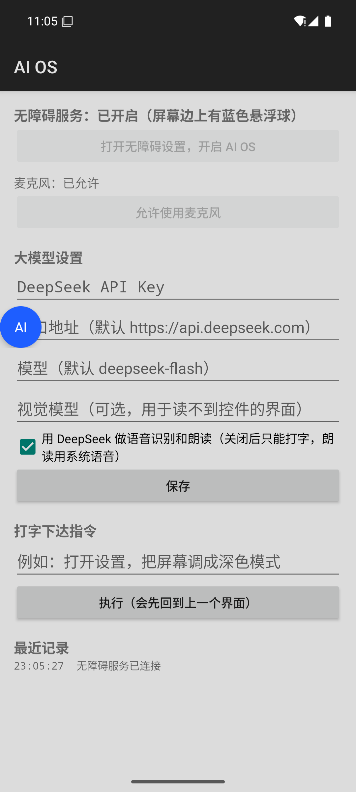

# AI OS for Android（预览版）

点一下屏幕边上的悬浮球说句话，DeepSeek 通过无障碍服务替你操作手机：打开应用、点按钮、输入文字、滚动、返回。

和 Windows 版同一套思路：读取前台应用的控件树并编号，模型按编号点击，每步只回传界面变化，不靠截图猜坐标。

> 预览版目前只在 Android 15 模拟器上验证过。

## 安装

1. 从 [GitHub Releases](https://github.com/pureheartrobotics/ai-os/releases) 下载 APK 安装（需要允许“安装未知应用”）。
2. 打开 AI OS，填入 DeepSeek API Key，保存。
3. 点「开启无障碍服务」，在系统设置里打开 AI OS。Android 13 及以上对侧载应用会先显示“受限设置”：到 设置 › 应用 › AI OS 右上角菜单里选「允许受限设置」后再开启。
4. 点「授予麦克风权限」。



之后屏幕边上会出现蓝色的 **AI** 悬浮球：点一下开始说话，执行过程中再点一下（红色 ■）立即停止。

## 能做什么

| 工具 | 作用 |
| --- | --- |
| `get_screen_elements` | 列出前台应用的可操作控件（带编号） |
| `click_element` / `tap_xy` | 按编号点击（支持长按），或按截图坐标点击 |
| `type_text` | 在输入框输入文字，可选按回车 |
| `press_key` | 返回、主屏幕、最近任务、通知栏、快捷设置、锁屏 |
| `scroll` | 上下左右滚动列表或整个屏幕 |
| `open_app` / `list_apps` / `open_url` | 按名字打开应用（含 设置、Wi‑Fi、蓝牙、相机 等系统页面）、查找已装应用、打开网址 |
| `look_at_screen` | 截图交给视觉模型（需要单独配置，Android 11 及以上） |
| `ask_user` | 语音追问用户 |

发送消息、付款、删除、拨打电话等操作，模型会先语音向你确认。

## 实测

Android 15 模拟器（Pixel 6 配置），模型 `deepseek-flash`，通过 adb 下发文字指令，每个任务只跑了一次，测试于 2026-11-18。结果用 `adb shell settings` 或截图核对过。

| 指令 | 结果 | 用时 | 工具调用 |
| --- | --- | --- | --- |
| 打开设置，把屏幕调成深色模式 | 成功 | 19.6 秒 | 7 次 |
| 打开设置，把屏幕超时时间改成 5 分钟 | 成功 | 12.2 秒 | 4 次 |
| 打开 Chrome，在必应上搜索 DeepSeek，告诉我第一条结果的标题 | 成功 | 10.5 秒 | 4 次 |
| 打开计算器，算一下 128 乘以 46 | 模拟器没装计算器，如实说明后口算给出 5888 | 15.7 秒 | 6 次 |

样本很小，只说明主流程能跑通，不代表各类应用上的成功率。

## 隐私与权限

- 无障碍服务可以读取屏幕上的所有文字。AI OS 只在你点悬浮球（或在设置页点“执行”）之后读取，并把控件文字发送给你配置的模型服务。
- 录音只在悬浮球显示“请说…”时进行，语音发送到 DeepSeek 语音识别。
- 不收集任何数据，没有自己的服务器。API Key 只保存在手机本地，不参与备份。

由于 Google Play 对无障碍服务有严格限制，AI OS 不上架 Play 商店，只通过 GitHub Releases 分发。

## 开发

需要 JDK 17+ 和 Android SDK（platform 35、build-tools 35.0.0）。

```sh
cd android
./gradlew testDebugUnitTest   # 控件编号、语音切分、上下文裁剪的单元测试
./gradlew assembleDebug
adb install -r app/build/outputs/apk/debug/app-debug.apk
adb shell settings put secure enabled_accessibility_services com.pureheartrobotics.aios/.AiOsService
adb shell settings put secure accessibility_enabled 1
```

不经过模型、直接调用单个工具（结果显示在 `data=` 里）：

```sh
adb shell "am broadcast -a com.pureheartrobotics.aios.TOOL -n com.pureheartrobotics.aios/.CommandReceiver --es name get_screen_elements"
adb shell "am broadcast -a com.pureheartrobotics.aios.TOOL -n com.pureheartrobotics.aios/.CommandReceiver --es name click_element --es args '{\"id\":4}'"
```

让 Agent 执行一条完整指令（需要先在设置页填好 API Key）：

```sh
adb shell "am broadcast -a com.pureheartrobotics.aios.RUN -n com.pureheartrobotics.aios/.CommandReceiver --es command '打开设置，把屏幕调成深色模式'"
```

这几个调试入口受 `android.permission.DUMP` 保护，只有 adb 能调用，手机上的其他应用调不了。

Windows 上如果单元测试报 `Gradle Test Executor ... finished with non-zero exit value 1`，检查系统 `PATH` 里是否有带引号的条目（例如 `"C:\Program Files\MySQL\MySQL Server 8.0\bin;"`），Gradle 会把它原样拼进测试进程的命令行。

## 代码结构

| 目录 | 内容 |
| --- | --- |
| `core/` | 纯 Kotlin、可在 JVM 上单测：控件编号与变化对比、语音切分（VAD）、对话上下文裁剪 |
| `screen/` | 从无障碍节点树读出控件 |
| `tools/` | 工具定义（OpenAI function 格式）和执行；与 Agent 解耦，后续可以原样暴露成 MCP |
| `agent/` | DeepSeek 对话循环、语音识别和合成接口 |
| `voice/` | 录音与朗读 |
| `ui/` | 设置页、悬浮球 |
