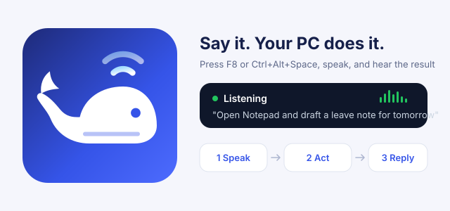

# dsh-ai-os



Replace mouse and keyboard with your voice: press F8, say what you want, and [DeepSeek Harness](https://github.com/deepseek-ai/deepseek-harness) operates your Windows desktop and answers aloud.

The agent reads the foreground window through Windows UI Automation, gets a numbered list of controls, and clicks, types, presses hotkeys, switches windows and launches apps. This is more precise than screenshot + OCR for native apps, and falls back to a vision model for web and Electron apps.

## Results

Six desktop tasks on one Windows 11 machine (Calculator input, Calculator mode switch, dark mode in Settings, a browser form, a new folder in File Explorer, writing and saving in Notepad), run in DeepSeek Harness with `deepseek-flash`, with and without this plugin:

| | DeepSeek Harness alone | + dsh-ai-os |
|---|---|---|
| Success | 6/6 | 6/6 |
| Median time | 166 s | 26 s |
| Tool calls (avg) | 12.3 | 9.2 |
| Tokens (avg) | 648K | 326K |

Without the plugin the agent writes PowerShell scripts that simulate keystrokes, screenshots the result and retries; with it, the agent clicks controls by number and each step returns only what changed on screen. One run per task, measured 2026-11-16.

The gap widens on real sessions. The same "list every open window" request measured on one machine: **17 min 10 s and 27 steps** without working desktop tools (the agent wrote `EnumWindows` PowerShell and hit a `danger-full-access` approval gate on every step), and **3 s with no approval prompts** once the `ai-os` tools were reachable.

## Install

```sh
pip install ai-os-desktop          # Python side, provides the ai-os-mcp command
dsh plugin add dsh-ai-os           # DeepSeek Harness side
```

Or install it from the plugin market: under **Plugins**, enable the experimental **Custom plugin index** plugin, then **Discover → Add index source** and paste

```
https://cdn.jsdelivr.net/npm/dsh-ai-os/market-index.json
```

This address always serves the latest release. If jsDelivr is unreachable on your network, use the pinned `https://unpkg.com/dsh-ai-os@<version>/market-index.json` instead. The market only installs the DeepSeek Harness side; `pip install ai-os-desktop` is still needed.

Tools appear in dsh as `mcp__ai-os__get_screen_elements`, `mcp__ai-os__click_element`, and so on. Try: "打开记事本，写一首关于秋天的诗".

## Hands-free voice

The plugin adds a whale button to the composer. Press **F8** (or click it), speak, and the transcript is sent as soon as you stop talking; a status card at the top of the window shows what it is doing (listening, recognizing, working, replying). The final reply is read aloud, then the microphone reopens for a follow-up for a few seconds. F8 while it is reading interrupts and listens again; Esc cancels.

**Ctrl+Alt+Space** works from any app: it brings DeepSeek Harness to the front and starts listening. Set `AI_OS_HOTKEY=off` to disable it.

Speech recognition reuses dsh's built-in **Voice Input** plugin (experimental), so no extra API key is needed: enable it under **Plugins** and complete its model preparation once. If you picked a microphone there, AI OS uses the same one. Replies are read with the system voice.

The plugin's page under **Plugins** checks that recognition is ready and has a microphone test (live level meter plus a sample transcription), which is the quickest way to tell a quiet microphone from a setup problem. Its 桌面操作 row reads the live MCP server status, so an unreachable Python side shows up as a red row with the actual error instead of a silent failure.

## Tools

| Tool | What it does |
| --- | --- |
| `get_screen_elements` | Numbered list of visible controls in the foreground window |
| `click_element` / `click_xy` | Click by control number, or by screenshot coordinates |
| `type_text` / `press_keys` / `scroll` | Keyboard and mouse input (Chinese text supported) |
| `open_app` / `open_url` / `open_path` | Launch apps, URLs, files |
| `list_windows` / `focus_window` | Window management |
| `look_at_screen` | Ask a vision model about the screen (set `VISION_MODEL`) |

Control numbers stay stable within a window, and every action that changes the screen returns only the controls that appeared or disappeared (a full list when the foreground window changes), so the agent sees the result of each step without screenshots.

## Safety

Shell commands are not exposed; use dsh's own shell tool, which goes through dsh's approval flow. Move the mouse to the top-left corner of the screen to abort any action immediately.

## Standalone voice mode

The same Python package also ships `ai-os`, a voice assistant that controls the desktop end to end with DeepSeek (LLM, ASR and TTS) using a single `DEEPSEEK_API_KEY`.
