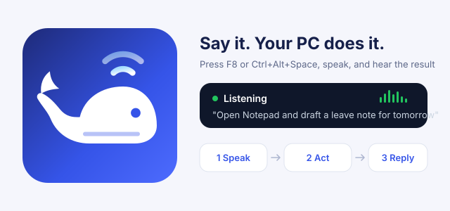

## Press F8 and talk

The whale button sits at the right of the composer. Press **F8** anywhere in DeepSeek Harness (or click the button) and speak. When you stop talking the transcript is sent automatically, and the final answer is read aloud. The microphone reopens for a few seconds afterwards, so you can keep talking without touching anything.

A status card at the top of the window shows what is happening: listening, recognizing, working, replying.

| Key | Effect |
| --- | --- |
| `F8` | Start listening, or interrupt the spoken reply and listen again |
| `Ctrl+Alt+Space` | From any other app: bring DeepSeek Harness forward and start listening |
| `Esc` | Cancel listening and stop the spoken reply |

## What the agent can do

The agent reads the foreground window through Windows UI Automation and gets a numbered list of controls. It clicks them by number, types text (Chinese included), presses hotkeys, scrolls, switches windows and launches apps. Numbering is stable inside a window, and every action that changes the screen returns only the controls that appeared or disappeared, so the agent knows each step worked without taking a screenshot.

For web pages and Electron apps, where UI Automation exposes little, it falls back to a screenshot plus a vision model.

## Setup

```sh
pip install ai-os-desktop     # the Python side: installs the ai-os-mcp command
dsh plugin add dsh-ai-os      # the DeepSeek Harness side
```

Then enable the built-in **Voice Input** plugin under **Plugins** and complete its model preparation once. Recognition reuses that plugin, so no extra API key is needed, and AI OS uses whichever microphone you chose there. Replies are spoken with the system voice.

Open **Plugins → AI OS** to see the readiness checks and run a microphone test: it shows a live level meter and the transcription of a four-second sample, which is the quickest way to tell a quiet microphone from a setup problem.

## Without the window

Run `ai-os service start` (and `ai-os service enable` to start it at login). Ctrl+Alt+Space then works from any app even when DeepSeek Harness is closed, and Ctrl+Alt+Esc stops it at any point: speech is recognized locally with the Voice Input model, the task runs through DSH's headless mode with your signed-in account, and the answer is read aloud.

## Troubleshooting

| Symptom | Fix |
| --- | --- |
| The desktop check is red | The Python side is not reachable. Run `pip install ai-os-desktop` and restart DeepSeek Harness. |
| The voice card says it heard nothing | Run the microphone test on the plugin page; check the default input device in Windows sound settings. |
| The agent writes PowerShell instead of using these tools | Tell it to use the `ai-os` tools, or restart DeepSeek Harness so the tool list and instructions are reloaded. |
| `Ctrl+Alt+Space` does nothing | `ai-os-mcp` must be running; it registers the hotkey. Set `AI_OS_HOTKEY=off` to disable it. |
