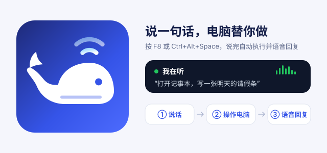

## 按 F8 说话

鲸鱼按钮在输入框右侧。在 DeepSeek Harness 里任何位置按 **F8**（或点这个按钮）就能说话；你说完，识别结果自动发送，最终回答会自动朗读。朗读结束后麦克风会再打开几秒，可以接着说，全程不用碰鼠标键盘。

窗口顶部的状态卡会显示当前在做什么：在听、识别中、执行中、回复中。

| 按键 | 作用 |
| --- | --- |
| `F8` | 开始说话；朗读时按下则打断并重新听 |
| `Ctrl+Alt+Space` | 在其他程序里也能用：把 DeepSeek Harness 拉到前台并开始听 |
| `Esc` | 取消聆听、停止朗读 |

## agent 能做什么

agent 通过 Windows UI Automation 读取前台窗口，拿到带编号的控件列表，然后按编号点击、输入文字（支持中文）、按快捷键、滚动、切换窗口、打开应用。同一窗口内编号保持不变，每个改变界面的操作只返回新增和消失的控件，所以 agent 不需要截图就能确认每一步的结果。

网页和 Electron 应用里 UI Automation 读不到内容时，会退回截图 + 视觉模型。

## 安装

```sh
pip install ai-os-desktop     # Python 端：提供 ai-os-mcp 命令
dsh plugin add dsh-ai-os      # DeepSeek Harness 端
```

然后在 **插件** 里启用内置的 **语音输入**，并完成一次模型准备。语音识别复用它，不需要额外的 API key；在那里选的麦克风 AI OS 也会用。回复用系统语音朗读。

打开 **插件 → AI OS** 可以看到运行检查和麦克风测试：测试会显示实时音量条和四秒录音的识别结果，用来区分“麦克风没声音”和“配置有问题”最快。

## 遇到问题

| 现象 | 处理 |
| --- | --- |
| 桌面操作检查是红的 | Python 端没连上。执行 `pip install ai-os-desktop`，然后重启 DeepSeek Harness。 |
| 语音卡片说没有听到声音 | 在插件页做一次麦克风测试；检查 Windows 声音设置里的默认输入设备。 |
| agent 用 PowerShell 而不是这些工具 | 让它改用 `ai-os` 工具；或重启 DeepSeek Harness 以重新加载工具列表和指令。 |
| `Ctrl+Alt+Space` 没反应 | `ai-os-mcp` 必须在运行，热键由它注册。设 `AI_OS_HOTKEY=off` 可以关掉。 |
